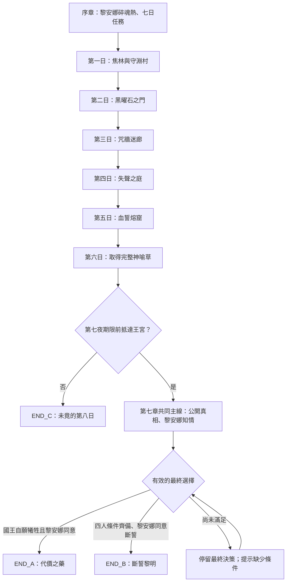

# 《七日之藥，深淵之願》結局觸發設計規格

**Filename:** `Ending_Trigger_Design_v1.0.md`  
**Version:** 1.0  
**Status:** 遊戲化設計基準／非已實作功能  
**Language:** 繁體中文  
**Scope:** 七日主線、章節錨點、結局 A／B／C、存檔與測試

## 1. 設計定位與資料優先序

此文件將小說中的**敘事錨點（Narrative Anchor）**對應至 RPG 所需的**狀態旗標（Gameplay Flag）**與**分歧觸發條件（Branch Trigger）**。它不主張這些遊戲機制已存在。

1. **故事原稿 Canon：** `STORY_MANUSCRIPT(1).md` 的七日、五層地下城、神喻草與三種結局。
2. **已定稿小說：** 第一至六章、第七章共同主線、A／B／C 各自獨立小說。
3. **各章 World & Character Bible：** 人物、道具及世界狀態的跨章約束。
4. **本文件新增遊戲規則：** 時限顯示、選項設計、旗標判斷、軟鎖防護、測試案例。此類是**新增設計**，不回溯宣稱為小說原文。

**核心限制：** 第六章四人已獲得完整、七葉的神喻草；C 是第七日返程逾期的**平行分歧**，不是「未取得神喻草」。第七章已成功回宮的共同主線只通往 A／B。A、B、C 互斥，尚未指定唯一正史。

## 2. 全局敘事流程



**不得將結局 C 設計成最終對話中的普通選項。** C 只能由實際逾期觸發。

## 3. 逐章 Narrative Anchors 與 Gameplay Flags

| 時間／任務 | 故事已建立的錨點 | 建議旗標 | 作用 | Canon／新增設計區分 |
|---|---|---|---|---|
| 序章 Q00 | 黎安娜病情、國王委託、七日倒數 | `quest_started`, `deadline_at` | 開始追蹤時限 | 倒數為 Canon；精確時間戳為新增 |
| 第一日 Q01 | 焦林見王室車隊、守淵村聞鐘聲、燈靈異變與王徽 | `royal_convoy_clue_found`, `old_royal_crest_found` | 建立王室疑點與線索紀錄 | 事件 Canon；旗標新增 |
| 第二日 Q02 | 四面銀鏡揭露秘密，四人承認，鏡影精靈放行 | `mirror_truth_trial_complete` | 角色信任基礎／通行 | 故事事件 Canon；旗標新增 |
| 第三日 Q03 | 保存被抹除姓名與誓約，里克特刻下兄長凱恩之名 | `memory_names_preserved`, `oath_inscription_recorded` | B 符文逆轉前置；共同主線舉證 | 故事事件 Canon；旗標新增 |
| 第四日 Q04 | 艾洛恩解縛石花巨獸、巨獸存活、獲透明種子 | `guardian_survived`, `transparent_seed_acquired` | B 的靈魂重織及倫理主題 | 故事事件 Canon；旗標新增 |
| 第五日 Q05 | 芙蕾雅破強制服從血誓，取得封村與處決密令 | `freya_blood_oath_broken`, `royal_orders_collected` | B 斷誓前置；共同主線罪證 | 故事事件 Canon；旗標新增 |
| 第六日 Q06 | 瑟維恩殘影、誓約真相、茵芮傾聽群靈、完整七葉草 | `inry_true_name_listening_completed`, `divine_herb_acquired`, `herb_leaf_count=7`, `oath_truth_discovered` | A/B 救治物件；結局理解基礎 | 故事事件 Canon；旗標新增 |
| 第七日返程 | 是否趕在第七夜完成回宮 | `arrived_before_deadline` | 是：共同主線；否：C | 逾時分歧 Canon；精確計算新增 |
| 第七日王宮 Q07 | 提出死亡名冊、密令，國王認知與公主知情 | `evidence_presented_to_king`, `royal_orders_presented`, `liana_informed_of_costs` | A/B 決策前必要程序 | 劇情 Canon；旗標新增 |
| 最終決策 | 黎安娜參與方案選擇，國王是否明確自願 | `liana_consent_recorded`, `king_explicit_voluntary_consent`, `final_choice` | A/B 互斥判定 | 故事意義 Canon；核准紀錄新增 |

### 3.1 核心劇情不可用「支線未完成」任意覆寫

目前小說已將 Q02–Q06 的關鍵事件寫成主線必然完成。遊戲若提供「未保存姓名」「未取得種子」等可失敗分支，**必須另寫對應的失敗敘事、補救路線或明示存檔回復方式**，不可只將 B 鎖定卻又讓玩家無法完成 A，形成不可解除的進度死鎖。

v1.0 的**推薦實作**：劇情主線旗標由必經任務保障；選擇主要集中在時限管理、資訊呈現、黎安娜知情決策與 A/B 的最終方案。進階版再擴充前章可失敗路線。

## 4. 七日倒數與結局 C

### 4.1 時間錨點

- **敘事基準：** 從王室確認只剩七日開始，到第七夜最後一聲鐘響前。
- **遊戲新增提案：** 使用內部時間 `story_time_minutes` 與固定 `deadline_at`，不使用現實裝置時鐘，避免離線與讀檔不一致。
- **時計設計：** UI 顯示「第 N 日／距第七夜尚餘時間」，在關鍵行動前提示所需時間。
- **時限判定點：** 回到王宮、開始最終共同主線**之前**原子性檢查一次 `arrival_time <= deadline_at`。邊界值採包含截止瞬間；若劇情要求「鐘響之前」嚴格排除等號，可於實作版調整為 `<`，但必須統一文案與測試。為避免歧義，本 v1.0 定為 `arrival_time < deadline_at`。

### 4.2 可用於 C 的延誤原因

既有結局 C 已寫成深淵返程路線變動導致延誤。遊戲可以把返程耗時與可見的路線選項結合；但**不得隨機瞬間推進一整夜且不警告玩家**。最低需求：在進入風險路線前明確提供「可能無法在第七夜前抵達」提示。

### 4.3 超時效果

- `arrived_before_deadline = false`；鎖定 `ending_id = END_C`。
- 不播放「已及時抵達王宮、當面揭露真相」的共同主線後半部分。
- 國王於第七夜啟動非自願備用儀式，公主失去意識，護界延續表面平靜；第八日守淵村再度響鐘。
- 四人仍已從第六章取得完整神喻草，不能改寫為空手而回。

## 5. 三結局觸發規格

### 5.1 END_A — 代價之藥

**觸發條件：** 按期回宮；向國王提出既有證據；黎安娜理解代價、明確同意接受方案；`final_choice = voluntary_sacrifice`；**國王本人再次確認自願奉出完整靈魂**。國王是此分支已定稿犧牲者，不可任意換成芙蕾雅。

**必須呈現的可觀察選擇：** 國王自行提出犧牲，艾洛恩確認不是脅迫或誤解，黎安娜得知可拒絕，然後才啟動儀式。不能只用「犧牲按鈕」代表同意。

**終局狀態：** 國王身亡／消失；黎安娜甦醒；護界與舊誓約持續；姓名記憶逐漸褪色，唯里克特刻名匕首保留見證；造成苦難的制度未被解決。

### 5.2 END_B — 斷誓黎明

**觸發條件：** 按期回宮、完整揭示代價、黎安娜知情同意、`final_choice = break_oath`，並具有下列四組前置成果：

1. **里克特：** `memory_names_preserved = true`（以姓名紀錄逆轉誓約符文）。
2. **芙蕾雅：** `freya_blood_oath_broken = true`（切斷王室血誓）。
3. **茵芮：** `inry_true_name_listening_completed = true`（依真名引導群靈）。
4. **艾洛恩：** `transparent_seed_acquired = true`（協助神喻草與殘存靈魂重織）。

**終局狀態：** 墜星之心破碎；誓約解除；被囚靈魂離去；黎安娜存活但失去大部分童年記憶；國王存活；護界熄滅，荒潮威脅出現在邊境。不可描寫成無代價的大團圓。

**缺前置成果時：** 禁用 B，清楚告知缺少哪些任務成果。v1.0 主線既然強制完成前置，不應出現此狀態；如果實際出現，應視為資料異常或非典型讀檔，先復原合法存檔，不應暗中自動轉 A。

### 5.3 END_C — 未竟的第八日

**唯一核心觸發：** `arrived_before_deadline = false`。不用 `final_choice`；不必進入黎安娜知情表決。

**終局狀態：** 國王存活並啟動強制備用儀式；黎安娜第七夜失去意識；護界暫維持；第八日守淵村鐘響；四人仍保有神喻草與調查證據，決意重返深淵。

**與 A/B 衝突限制：** 絕不可同時設 `liana_awake = true`、`king_alive = false` 或 `oath_active = false`，亦不得在成功回宮後憑「拒絕立即選擇」硬切入 C。

## 6. 玩家實際互動與對話錨點（新增設計）

| 互動 ID | 章節與場景 | 玩家可見行動 | 結果／敘事用途 |
|---|---|---|---|
| `INT-Q03-NAMES` | 咒牆迷廊 | 保全姓名並重組符文 | 寫入 B 能力錨點與凱恩姓名證據 |
| `INT-Q04-RELEASE` | 失聲之庭 | 選擇非致命解縛、取得種子 | 寫入 B 重織錨點；巨獸必須存活 |
| `INT-Q05-BREAK` | 血誓熔窟 | 不以亡父之骨持續攻擊，而是解除血誓 | 寫入 B 斷誓錨點；血咒減弱 |
| `INT-Q06-LISTEN` | 墜星之心 | 茵芮傾聽靈名、取得完整草 | 寫入 B 引導錨點、A/B 救治物件 |
| `INT-RETURN` | 第六日→第七日返程 | 選擇有時間資訊的路線／行動 | 可能準時或逾時；只此處能進 C |
| `INT-Q07-EVIDENCE` | 王宮藥室 | 提交死亡名冊及封村密令 | 開啟完整知情討論 |
| `INT-Q07-LIANA` | 王宮藥室 | 向黎安娜告知 A 與 B 真實代價 | 記錄她的知情意願 |
| `INT-Q07-CHOICE` | 王宮藥室 | 選擇接受自願犧牲或斬斷誓約 | A/B 最終不可逆選擇 |

上述前四個互動是把**小說中已發生的固定事件**映射成遊戲節點，並非授權玩家任意否定原稿。如果未來需要真正多路線的早期選擇，需另開 `v1.1` 設計替代章節。

## 7. 狀態資料 Schema（建議）

```yaml
schema_version: "1.0"
quest_id: Q07
chapter_id: CH07
story_clock:
  story_time_minutes: 0     # Set by the game's deterministic story clock
  deadline_at: null         # Required once the prologue countdown begins
  arrival_time: null
flags:
  quest_started: false
  royal_convoy_clue_found: false
  old_royal_crest_found: false
  mirror_truth_trial_complete: false
  memory_names_preserved: false
  oath_inscription_recorded: false
  guardian_survived: false
  transparent_seed_acquired: false
  freya_blood_oath_broken: false
  royal_orders_collected: false
  inry_true_name_listening_completed: false
  divine_herb_acquired: false
  herb_leaf_count: 0
  oath_truth_discovered: false
  arrived_before_deadline: null
  evidence_presented_to_king: false
  royal_orders_presented: false
  liana_informed_of_costs: false
  liana_consent_recorded: false
  king_explicit_voluntary_consent: false
  final_choice: null
  ending_id: null
world_state:
  king_alive: true
  liana_awake: false
  barrier_active: true
  oath_active: true
  herb_used: false
  wild_tide_visible: false
  transparent_seed_held_by_eron: false
branch_metadata:
  branch_locked: false
  locked_at_story_time: null
  decision_reason: null
```

**資料規則：**
- `ending_id` 僅允許 `null | END_A | END_B | END_C`。
- `final_choice` 僅允許 `null | voluntary_sacrifice | break_oath`；C 不設此欄位的選擇值。
- `herb_leaf_count` 為整數；第六章取得後必須是 `7`，儀式前不允許零碎消耗。
- 對 `arrived_before_deadline`、同意旗標及 `ending_id` 的寫入必須有事件 ID／原因紀錄，避免讀檔時無法還原分歧依據。
- `liana_awake` 表示結局救治後的清醒狀態；共同主線中公主短暫清醒、開口說話，不等於已經康復，避免以單一布林值混淆。
- 結局 A 中刻名匕首能保留記錄；人們對國王的記憶仍會褪色，不能以保有刻字等於全部人永遠記得國王。

## 8. 決策函式（純邏輯參考）

```python
from typing import Any


def resolve_ending(state: dict[str, Any]) -> str | None:
    flags = state["flags"]
    time_state = state["story_clock"]

    if not flags["divine_herb_acquired"] or flags["herb_leaf_count"] != 7:
        return None

    if time_state["arrival_time"] is None or time_state["deadline_at"] is None:
        return None

    if time_state["arrival_time"] >= time_state["deadline_at"]:
        return "END_C"

    required_disclosure = (
        "evidence_presented_to_king",
        "royal_orders_presented",
        "liana_informed_of_costs",
        "liana_consent_recorded",
    )
    if not all(flags[name] for name in required_disclosure):
        return None

    if flags["final_choice"] == "voluntary_sacrifice":
        return "END_A" if flags["king_explicit_voluntary_consent"] else None

    if flags["final_choice"] == "break_oath":
        requirements = (
            "memory_names_preserved",
            "freya_blood_oath_broken",
            "inry_true_name_listening_completed",
            "transparent_seed_acquired",
        )
        return "END_B" if all(flags[name] for name in requirements) else None

    return None
```

本函式僅計算應進入哪個結局；**世界狀態寫入、播放劇情、鎖定存檔應由獨立流程處理**。不能在偵測 `END_A` 時先修改國王存活狀態，再詢問玩家確認。

## 9. 不可逆提交、存檔與回復

**推薦存檔節點：**

- `chapter6_herb_acquired`：取得完整神喻草；尚未結算返程時間。
- `chapter7_before_arrival_check`：返程結果檢查前。
- `chapter7_predecision`：確定準時、共同主線真相公開後；可選 A 或 B。
- `chapter7_late_arrival`：確定逾時，進入 C 專屬劇情。
- `ending_A_final`、`ending_B_final`、`ending_C_final`：各自終局快照。

**提交規則：**
1. 驗證所有條件、角色同意與時限後，才進行分支鎖定。
2. `ending_id` 一旦確定，於同一遊戲流程內不可再切換到另一結局；玩家如欲看其他結局，須載入分歧前存檔。
3. 各結局有獨立的 `world_state`，不可用 A 的 `king_alive=false` 污染 B/C。
4. C 的劇情存檔不能以共同主線「已回宮」進度旗標為基礎。
5. 儀式演出中發生儲存失敗時，回到分歧前一致性快照，不保留部分更新。

## 10. 結局最終世界狀態矩陣

| 狀態 | END_A | END_B | END_C |
|---|---|---|---|
| 國王 | 自願犧牲；消失 | 存活 | 存活 |
| 黎安娜 | 存活、甦醒 | 存活、失去大部分童年記憶 | 第七夜失去意識，未完成救治 |
| 墜星誓約 | 延續 | 解除 | 因備用儀式延續 |
| 王國護界 | 維持 | 熄滅 | 暫時維持 |
| 群靈 | 整體束縛未終結 | 離開拘禁狀態 | 未得到全面解放 |
| 荒潮 | 未因本結局解誓而出現 | 於邊境顯現威脅 | 未因解誓而出現 |
| 神喻草 | 用於儀式 | 用於重織 | 已取得但未及時使用 |
| 里克特匕首 | 保留犧牲者姓名記錄 | 保留凱恩刻名等紀錄 | 保留既有刻名 |
| 第八日守淵村異鐘 | 無此事件 | 無此事件 | 發生 |

矩陣描述結局文本已確認的結果。沒有明示的細節，例如每名群靈的去向、荒潮具體生態與公主病後長期預後，仍不得由系統臆測為完全確定。

## 11. QA 與驗收測例

| Test ID | 輸入條件 | 預期結果 |
|---|---|---|
| T01 | 第六章草已得七葉，準時，完成揭露與同意，國王自願，選 A | `END_A` |
| T02 | 準時，完整揭露，黎安娜同意，四項前置全真，選 B | `END_B` |
| T03 | 草已得七葉，返程晚於截止 | `END_C`，不進共同主線 |
| T04 | 返程恰好等於截止時間 | `END_C`，符合本版「鐘響前」嚴格判斷 |
| T05 | 未記錄 `arrival_time` | 不決定結局；要求完成時限檢查 |
| T06 | 選 A，但 `king_explicit_voluntary_consent=false` | 不進 A；留在最終選擇 |
| T07 | 選 B，但缺少透明種子 | 不進 B；顯示缺少前置，視為需修復的主線異常 |
| T08 | 玩家停留在選擇畫面，未選方案 | 不自動進 C；保留共同主線決策狀態 |
| T09 | A 存檔進入儀式後載入 B 結局 | 必須由分歧前存檔重選；不得混合世界狀態 |
| T10 | 第六章有神喻草，第七日返程逾時 | C 仍保留「已取得神喻草」的歷史事實 |
| T11 | 神喻草未完整取得，卻請求觸發 A/B | 拒絕觸發；記錄資料不一致 |
| T12 | 分支提交時儲存失敗 | 回復到合法分歧前快照 |
| T13 | 國王未明確自願卻由系統推定同意 | 必須拒絕 A |
| T14 | 結局 B 完成後國王被設為死亡 | 驗證失敗；B 國王必須存活 |
| T15 | 結局 C 播放「黎安娜已知情選擇」場景 | 驗證失敗；C 不進入及時回宮共同主線 |

## 12. 跨章修改控制與後續版本

**本版定稿：**
- 三結局觸發核心：準時／逾時 → A/B 或 C。
- A 的犧牲者固定為**國王自願**；B 需要四位角色前章成果；C 必須是真正逾時。
- 第七章真相公開及黎安娜知情，不可被純 UI 點擊代替。
- A/B/C 不互相覆蓋，也不指定唯一正史。

**仍屬未決、不得自行視為已實作：**
- 每個探索互動消耗的精確分鐘數；返程各路線的路徑與時間成本。
- 前章是否允許玩家失敗、以及失敗替代劇情（本 v1.0 預設主線事件必達）。
- 時限提示 UI、戰鬥耗時、讀檔回退上限與自動存檔頻率。
- 國王的正式本名、荒潮具體生態與備用祭品身分。

**擴展要求：** 任一後續版本如果增加第四種結局、其他犧牲人選、可失敗的前章關卡，必須先更新 Canon／章節替代文本與 QA 測例，不可只修改旗標判定。

---

**版本記錄**

- **v1.0：** 整合七日七章與三結局的敘事錨點、時限分歧、A/B 自願與知情條件、狀態 Schema、判定參考、存檔隔離及 QA 案例。
